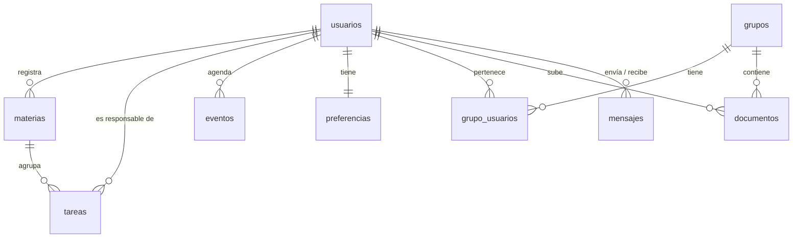

# Agenda estudiantil · Parte de Julián (BD, servidor, auth, grupos y documentos)

Arquitectura: **Frontend** (HTML + CSS + JS) ⇄ **Backend** (Node.js + Express) ⇄ **Base de datos** (MariaDB/MySQL).

## Puesta en marcha (en cualquier computadora)

1. Instalar Node.js (v18 o superior) y MariaDB. Tener un cliente (DBeaver o HeidiSQL) es opcional.
2. En la carpeta del proyecto:
   ```
   npm install
   copy .env.example .env        (Windows)   |   cp .env.example .env   (Mac/Linux)
   ```
3. Editar `.env`: poner `DB_USER` y `DB_PASSWORD` de su MariaDB y cambiar `JWT_SECRET` por una frase larga.
4. Crear la BD con datos de prueba (se puede repetir las veces que sea necesario, deja todo limpio):
   ```
   npm run db:reset
   ```
5. Arrancar: `npm start`  →  http://localhost:3000  ·  comprobar en http://localhost:3000/api/salud

**Usuarios de prueba** (contraseña de todos: `Demo1234`): julian@demo.com, dana@demo.com, alexa@demo.com, leslie@demo.com, piloto@demo.com

Las fechas del seed son relativas a la fecha en que se corre `npm run db:reset`. Corranlo **el día de la presentación**.

## Para el resto del equipo

- **Token:** todas las rutas, excepto `/api/auth/registro` y `/api/auth/login`, exigen `Authorization: Bearer <token>`. El middleware ya está aplicado desde `server.js`; las rutas de Dana solo leen `req.id_usuario` para filtrar.
- **Cómo se registran las rutas de Dana:** basta con crear `routes/materias.js`, `tareas.js`, `eventos.js` y `calendario.js` exportando un `express.Router()`. `server.js` las detecta solo.
- **Conexión a BD:** `const db = require('../db');` y `await db.query('SELECT ... WHERE id_usuario = ?', [req.id_usuario])`. Siempre con `?`, nunca concatenando texto.
- **Fechas:** las columnas DATE llegan como texto `'2026-11-09'` (ya no hay problemas de zona horaria con FullCalendar).
- **Errores:** siempre JSON `{ "error": "mensaje" }` con el código HTTP correspondiente.

## Endpoints de esta parte

| Método y ruta | Recibe | Devuelve | Permiso |
|---|---|---|---|
| POST `/api/auth/registro` | nombre, apellido, correo, contrasena | usuario creado (201) | público |
| POST `/api/auth/login` | correo, contrasena | `{ token, usuario }` | público |
| GET `/api/auth/yo` | | datos del usuario con sesión | token |
| GET `/api/grupos` | | grupos del usuario con `rol` y `num_miembros` | token |
| POST `/api/grupos` | nombre, descripcion | grupo creado; el creador queda `admin` | token |
| GET `/api/grupos/:id` | | detalle y rol del usuario | miembro |
| GET `/api/grupos/:id/miembros` | | miembros con rol | miembro |
| POST `/api/grupos/:id/miembros` | correo | miembro agregado (201) | admin |
| GET `/api/grupos/:id/documentos` | | documentos con `subido_por` | miembro |
| POST `/api/grupos/:id/documentos` | nombre, url | documento registrado (201) | miembro |
| DELETE `/api/grupos/:id/documentos/:idDoc` | | confirmación | quien lo subió o admin |

Códigos: 400 datos inválidos · 401 sin sesión o token vencido · 403 sin permiso · 404 no existe · 409 duplicado.

## Diagrama entidad-relación


(Pegarlo en https://mermaid.live para exportarlo como imagen, o generarlo con DBeaver: clic derecho en la BD → *View Diagram*.)

## Seguridad: qué implementamos (para la presentación)

| Medida | Dónde | Cómo mostrarla |
|---|---|---|
| Contraseñas con hash **bcrypt** | `routes/auth.js` | `SELECT correo, contrasena FROM usuarios;` solo muestra hashes (`$2b$10$...`) |
| Sesión con **JWT** que expira (8 h) | `routes/auth.js`, `middleware/auth.js` | Petición sin token o con token falso → 401 |
| **Consultas parametrizadas** (`?`) | todas las rutas | Probar `' OR '1'='1` en el login → rechazado |
| **Aislamiento de datos** por usuario y por grupo | `middleware/grupo.js` | Un usuario ajeno al grupo pide sus miembros → 403 |
| **Roles** (admin / miembro) | `routes/grupos.js` | Un miembro intenta agregar gente → 403 |
| Mensaje de login genérico | `routes/auth.js` | No revela si el correo existe |
| Validación de entradas y URLs | todas las rutas | Documento con `javascript:` → 400 |
| Credenciales fuera del código | `.env` (en `.gitignore`) | No aparece en el repositorio |
| Integridad referencial | `schema.sql` | Llaves foráneas, `UNIQUE` en correo, `CHECK` en estado, tipo y rol |

**Trabajo futuro:** HTTPS, despliegue en la nube con cifrado en reposo, límite de intentos de login, respaldos automáticos y recuperación de contraseña.

## Estructura

```
db/schema.sql · db/seed.sql · db/instalar.js · db/generar_hash.js
db.js · server.js · middleware/{auth,grupo}.js
routes/{auth,grupos,documentos}.js        ← Julián
routes/{materias,tareas,eventos,calendario}.js   ← Dana
public/                                    ← Leslie y Alexa
```
